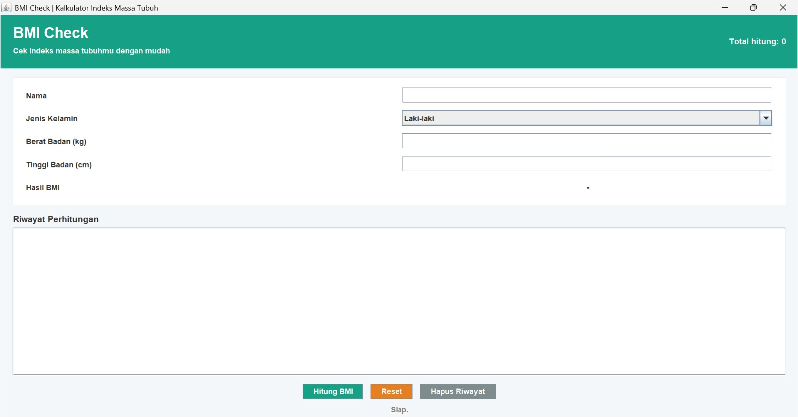
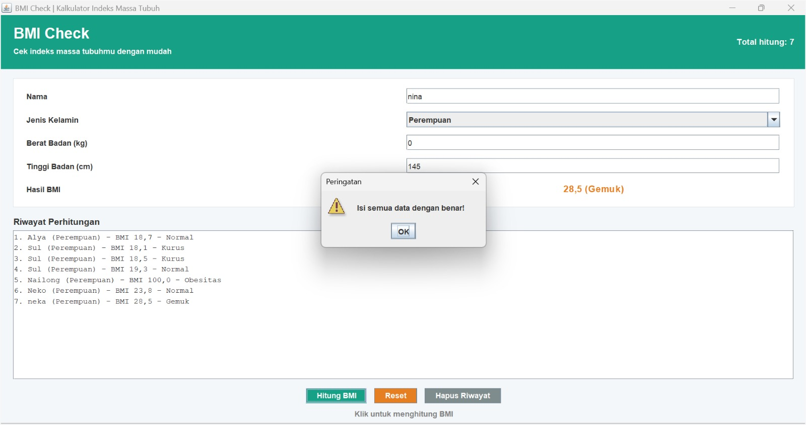
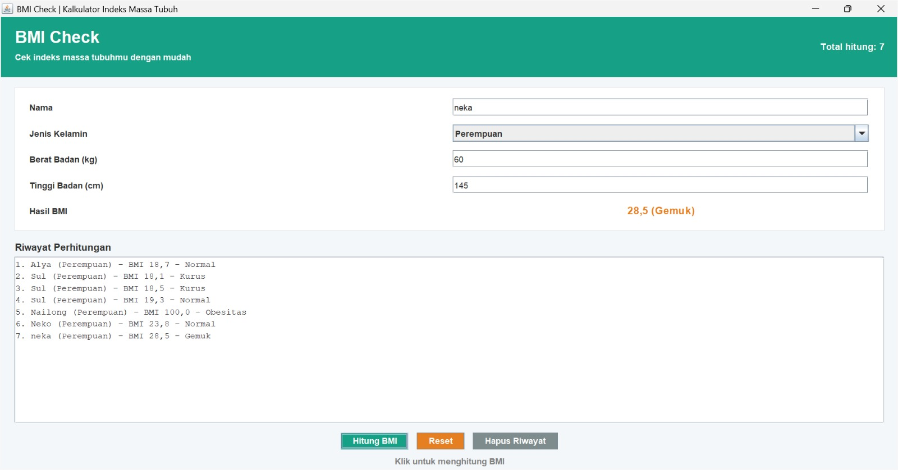

# BMI Check 

## Nama: Alya Rasyida Putri  
## NIM: F1D02410002

---

## 1. Deskripsi Aplikasi

BMI Check adalah aplikasi desktop berbasis Java Swing untuk membantu pengguna menghitung Indeks Massa Tubuh (BMI). Pengguna dapat memasukkan nama, memilih jenis kelamin, memasukkan berat badan dan tinggi badan, kemudian menghitung nilai BMI beserta kategorinya. Aplikasi juga menyediakan riwayat perhitungan, jumlah total perhitungan, serta fitur untuk mereset form dan menghapus riwayat.

Rumus perhitungan BMI:

`BMI = berat badan (kg) / (tinggi badan (m) × tinggi badan (m))`

Kategori BMI yang ditampilkan adalah Kurus, Normal, Gemuk, dan Obesitas.

## 2. Fitur Aplikasi

- Memasukkan nama pengguna.
- Memilih jenis kelamin.
- Memasukkan berat badan dalam kilogram.
- Memasukkan tinggi badan dalam sentimeter.
- Menghitung nilai BMI secara otomatis.
- Menampilkan kategori BMI dengan warna berbeda.
- Menyimpan riwayat perhitungan selama aplikasi berjalan.
- Menampilkan jumlah total perhitungan.
- Mereset form input.
- Menghapus riwayat perhitungan.
- Menampilkan pesan peringatan jika input tidak valid.
- Menghitung BMI dengan menekan tombol Enter pada kolom tinggi badan.

## 3. Teknologi

- Bahasa pemrograman: Java
- Library GUI: Java Swing
- Library pendukung: Java AWT
- IDE: Visual Studio Code
- JDK: Java Development Kit

## 4. Komponen GUI

### Top-Level Container

- `JFrame`: digunakan sebagai jendela utama aplikasi BMI Check.
- `getContentPane()`: digunakan untuk mengakses wadah utama komponen GUI.
- `JOptionPane`: digunakan untuk menampilkan pesan peringatan dan kesalahan kepada pengguna.

### Intermediate Components

- `JPanel`: mengelompokkan komponen berdasarkan bagian tampilan, seperti header, form input, riwayat, tombol, dan status aplikasi.
- `JScrollPane`: menyediakan area yang dapat digulir untuk melihat riwayat perhitungan BMI.

### Atomic Components

- `JLabel`: menampilkan judul, subjudul, jumlah perhitungan, label input, hasil BMI, dan status aplikasi.
- `JTextField`: menerima input nama, berat badan, dan tinggi badan.
- `JComboBox`: menyediakan pilihan jenis kelamin.
- `JButton`: menjalankan tindakan Hitung BMI, Reset, dan Hapus Riwayat.
- `JTextArea`: menampilkan riwayat perhitungan BMI.

## 5. Layout Manager

### BorderLayout

Mengatur komponen pada bagian utara, selatan, timur, barat, dan tengah. Pada aplikasi ini, `BorderLayout` digunakan untuk mengatur posisi header, panel tengah, panel bawah, serta komponen di dalam beberapa panel.

### GridLayout

Menyusun komponen dalam bentuk baris dan kolom dengan ukuran sel yang sama. Pada aplikasi ini, `GridLayout` digunakan untuk menyusun judul dan subjudul serta form input BMI.

### FlowLayout

Menyusun komponen secara berurutan dalam satu baris. Pada aplikasi ini, `FlowLayout` digunakan untuk menyusun tombol Hitung BMI, Reset, dan Hapus Riwayat secara horizontal.

## 6. Event Handling

Aplikasi ini menerapkan Delegation Event Model untuk menangani interaksi pengguna. Terdapat dua interface yang diimplementasikan langsung oleh class `BMICalculator`, yaitu `ActionListener` dan `MouseListener`. Program juga menggunakan `KeyAdapter` untuk menangani penekanan tombol keyboard.

### ActionListener

`ActionListener` digunakan untuk menangani aksi ketika tombol ditekan.

- `actionPerformed(ActionEvent e)`: menangani aksi pada tombol Hitung BMI, Reset, dan Hapus Riwayat.
- `e.getSource()`: digunakan untuk mengetahui tombol yang memicu event.
- Tombol Hitung BMI menjalankan proses perhitungan BMI.
- Tombol Reset mengosongkan form input dan mengembalikan pilihan jenis kelamin ke pilihan awal.
- Tombol Hapus Riwayat menghapus daftar riwayat perhitungan.

### MouseListener

`MouseListener` digunakan untuk menangani interaksi mouse pada tombol.

- `mouseEntered(MouseEvent e)`: menampilkan informasi ketika kursor diarahkan ke tombol.
- `mouseExited(MouseEvent e)`: mengembalikan teks status menjadi "Siap.".
- `mouseClicked(MouseEvent e)`: diimplementasikan sebagai bagian dari interface `MouseListener`.
- `mousePressed(MouseEvent e)`: diimplementasikan sebagai bagian dari interface `MouseListener`.
- `mouseReleased(MouseEvent e)`: diimplementasikan sebagai bagian dari interface `MouseListener`.

### KeyAdapter

`KeyAdapter` digunakan untuk menangani penekanan tombol keyboard pada kolom tinggi badan.

- `keyPressed(KeyEvent e)`: mendeteksi tombol yang ditekan.
- `KeyEvent.VK_ENTER`: digunakan untuk mendeteksi tombol Enter.
- Ketika Enter ditekan pada kolom tinggi badan, program akan menjalankan method `hitungBMI()`.

## 7. Cara Menjalankan

Pastikan Java Development Kit (JDK) sudah terpasang dan terminal berada di folder tempat file `BMICalculator.java` disimpan.

Kompilasi program:

```bash
javac BMICalculator.java
```

Jalankan program:

```bash
java BMICalculator
```

Jika diperlukan, program juga dapat dijalankan menggunakan:

```bash
java -cp . BMICalculator
```

8. Struktur Proyek

Tugass GUI/
├── BMICalculator.java
├── README.md
└── screenshot/
    ├── awall.jpeg
    ├── validasi.jpeg
    └── hasil.jpeg

Keterangan:

BMICalculator.java: berisi kode sumber aplikasi BMI Check.

README.md: berisi deskripsi aplikasi, fitur, komponen GUI, event handling, dan cara menjalankan program.

screenshot/awall.jpeg: dokumentasi tampilan awal aplikasi BMI Check.

screenshot/validasi.jpeg: dokumentasi pesan peringatan ketika pengguna memasukkan data yang tidak valid.

screenshot/hasil.jpeg: dokumentasi tampilan aplikasi setelah perhitungan BMI dilakukan.

9. Penyimpanan Data

Data perhitungan BMI disimpan sementara di memori selama aplikasi berjalan. Riwayat perhitungan ditampilkan pada komponen JTextArea, sedangkan jumlah perhitungan disimpan menggunakan variabel jumlahHitung. Data tidak disimpan ke database atau file permanen, sehingga riwayat perhitungan akan hilang ketika aplikasi ditutup.

10. Dokumentasi Screenshot

Tampilan Awal

Menampilkan tampilan awal aplikasi BMI Check sebelum perhitungan dilakukan, termasuk form input nama, jenis kelamin, berat badan, tinggi badan, dan riwayat perhitungan.


Validasi Input

Menampilkan pesan peringatan ketika pengguna memasukkan data yang tidak valid. Pada contoh ini, berat badan diisi dengan angka 0 sehingga aplikasi menampilkan pesan "Isi semua data dengan benar!".


Hasil Perhitungan BMI

Menampilkan hasil perhitungan BMI beserta kategori BMI, jumlah total perhitungan, dan riwayat perhitungan yang telah dilakukan.
